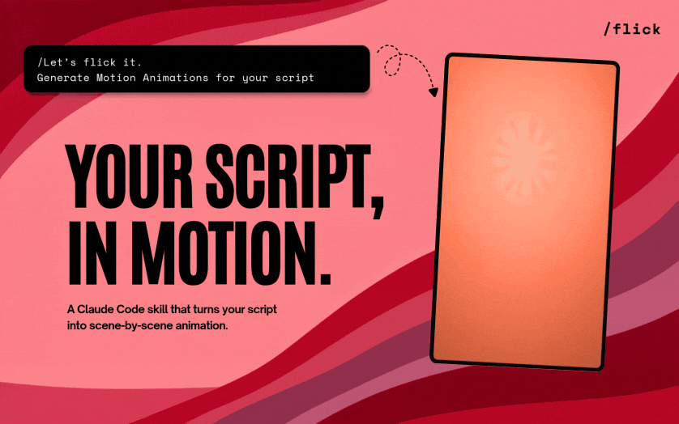
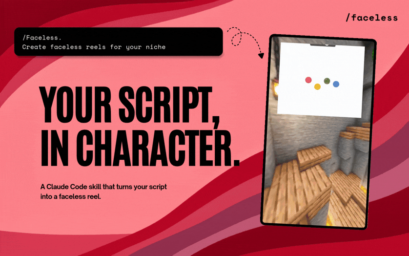

# Content Master

Open-source tools to turn scripts and transcripts into animations, character reels, and automated video workflows.

Maintained by [Bearozgaarmard](https://github.com/baerozgaarmard).

---

## What's Inside

| Package | Role | Description |
|---|---|---|
| [**`flick`**](packages/flick) | **Motion Director** | Turns videos, links, or transcripts into scene-by-scene animations in Remotion Studio. |
| [**`faceless`**](packages/faceless) | **Dialogue Reels** | Generates Peter & Stewie or Rick & Morty dialogue reels with VoiceStudio local voice cloning and Minecraft parkour backgrounds. |

---

## Demos

### 1. Flick (Scene-by-Scene Remotion Animations)



Turn a transcript or script into timed, editable scene animations with audio-matched sound effects.

### 2. Faceless (Character Dialogue Shorts)



Split-screen character dialogue reels with local voice cloning, reactive speaker animations, and centered highlight captions.

---

## 🚀 Quick Start for Clone Users

If you cloned this repository directly to your machine:

```bash
git clone https://github.com/baerozgaarmard/content-master.git
cd content-master
npm install
```

### Prerequisites
- **Node.js**: v18 or later
- **Python**: 3.10+ (for local voice synthesis fallback)
- **VoiceStudio (Optional)**: [VoiceStudio](https://github.com/debpalash/VoiceStudio) running locally at `http://127.0.0.1:3900` for zero-shot voice cloning (falls back to local neural TTS automatically).
- **FFmpeg**: Automatically provisioned by the scripts on first run.

---

### Step-by-Step: Creating a Faceless Character Reel

#### 1. Download Background Templates
Download the Minecraft vertical gameplay pack (or drop your own 1080x1920 MP4 into `packages/faceless/skills/faceless/video-templates/`):
```bash
node packages/faceless/skills/faceless/scripts/download-templates.mjs --replace
```

#### 2. Create Dialogue Script
Create a JSON file with speaker turns (Rick voice ID: `d2e75a3e3fd6419893057c02a375a113`, Morty: `3d445d095ba04681bcba7177faedf55a`, Peter: `e34b4e061b874623a08f41e5c4fecfb9`, Stewie: `fdffd3722cd040fcb3f95eec5a7f29f3`):

```json
[
  {"text": "Morty! You have to check this out!", "index": 0, "voiceId": "d2e75a3e3fd6419893057c02a375a113"},
  {"text": "Aw jeez Rick, what did you do this time?", "index": 1, "voiceId": "3d445d095ba04681bcba7177faedf55a"}
]
```

#### 3. Generate Character Audio
```bash
node packages/faceless/skills/faceless/scripts/generate-audio.mjs --script path/to/dialogue.json --topic my-short --output faceless-output
```

#### 4. Render the Final Video
Renders gameplay, character entrance animations, word-by-word gold-accented captions, and master audio in a single pass:
```bash
node packages/faceless/skills/faceless/scripts/render-faceless-reel.mjs --topic my-short --output faceless-output
```
Your final reel will be ready at `faceless-output/video/my-short/final-faceless-reel.mp4`.

---

### Step-by-Step: Creating Remotion Scene Animations with Flick

```bash
cd packages/flick
npm install
npm run dev
```
Opens Remotion Studio locally where you can preview, animate, and render motion scenes driven by transcripts.

---

## Using with AI Coding Assistants (Agent Skills)

### Agent Skills (Codex, Antigravity, Cursor)

```bash
# Install Flick
npx skills add baerozgaarmard/content-master --skill flick --global --yes

# Install Faceless
npx skills add baerozgaarmard/content-master --skill faceless --global --yes
```

### Claude Code Plugins

```bash
# Register marketplace
/plugin marketplace add baerozgaarmard/content-master

# Install skills
/plugin install flick@content-master
/plugin install faceless@content-master
```

---

## Monorepo Structure

```text
content-master/
├── packages/
│   ├── flick/       # Remotion motion director, sound effects & templates
│   └── faceless/    # Character dialogue engine, voice cloning & compositor
├── skills/          # Root skill discovery for npx skills
│   ├── flick/
│   └── faceless/
├── assets/          # Real demo assets
├── package.json
└── LICENSE
```

---

## Video Understanding & Ingestion

Content Master integrates with [**watch-skill**](https://github.com/oxbshw/watch-skill) to give agents eyes and ears — inspecting raw videos, extracting clean dialogue cues, and generating timestamped scene evidence for animation and reel generation.

---

## Search Topics

`ai-video-generator` • `remotion` • `youtube-automation` • `faceless-channel` • `faceless-reels` • `shorts-generator` • `text-to-video` • `whisper` • `voicestudio` • `voice-cloning` • `watch-skill` • `elevenlabs-alternative` • `bearozgaarmard`

---

## License

MIT © 2026 Bearozgaarmard. Portions derived from Creatorberry under MIT license. See [LICENSE](LICENSE).
