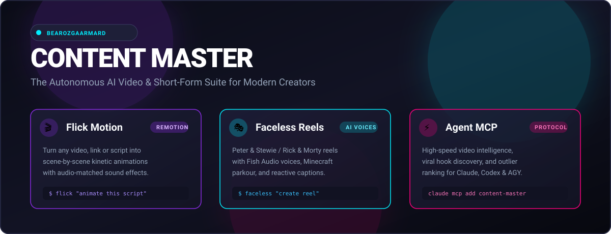
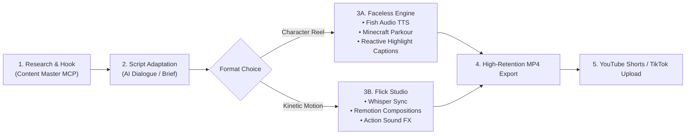

<div align="center">



# 🎬 Content Master

### The Autonomous Open-Source AI Video & Short-Form Suite for Modern Creators

[](https://opensource.org/licenses/MIT)
[](https://nodejs.org/)
[](https://www.remotion.dev/)
[](https://youtube.com)
[](https://github.com/baerozgaarmard)

*A battle-tested AI suite developed and maintained by [**Bearozgaarmard**](https://github.com/baerozgaarmard) to help creators research, script, animate, and publish viral YouTube videos and short-form content faster.*

[🚀 Quick Start](#-quick-install) • [🎬 Visual Demos](#-visual-demos) • [📺 YouTube Automation](#-youtube-automation-playbook) • [📦 Packages](#-packages-in-this-suite) • [🔍 Keywords](#-search--discovery-keywords)

</div>

---

## 🎬 Visual Demos

<table align="center" width="100%">
  <tr>
    <td width="50%" align="center">
      <h3>🎬 Flick: AI Motion Director</h3>
      <p><i>Turn transcripts &amp; scripts into scene-by-scene kinetic Remotion animations.</i></p>
      
    </td>
    <td width="50%" align="center">
      <h3>🎭 Faceless: Dialogue Reel Engine</h3>
      <p><i>Turn scripts into Peter &amp; Stewie or Rick &amp; Morty reels over 60FPS Minecraft parkour.</i></p>
      
    </td>
  </tr>
</table>

---

## 🌟 Suite Overview

**Content Master** bundles the complete next-generation AI content creation stack into a single, cohesive monorepo:

| Package | Directory | Role | Description |
|---|---|---|---|
| 🎬 **Flick** | [`packages/flick`](packages/flick) | **AI Motion Director** | Converts videos, links, or scripts into scene-by-scene motion animations rendered with Remotion Studio. |
| 🎭 **Faceless** | [`packages/faceless`](packages/faceless) | **Dialogue Reel Generator** | Creates viral split-screen character reels (Peter & Stewie / Rick & Morty) with Fish Audio TTS and Minecraft parkour backgrounds. |
| ⚡ **MCP Client** | [`packages/mcp`](packages/mcp) | **Agent Data Connector** | Connects Claude Code, Codex, and Antigravity agents directly to video analytics, outlier hooks, and transcript breakdowns. |

---

## 🚀 Quick Install

### 1. Antigravity / Codex / Agent CLIs

Install globally with a single command via `npx skills`:

```bash
# Install Flick (Remotion scene animator)
npx skills add baerozgaarmard/content-master --skill flick --global --yes

# Install Faceless (Character dialogue reel generator)
npx skills add baerozgaarmard/content-master --skill faceless --global --yes
```

### 2. Claude Code

Install directly as plugins:

```bash
# Add repository marketplace & install Flick
/plugin marketplace add baerozgaarmard/content-master
/plugin install flick@content-master

# Install Faceless
/plugin install faceless@content-master
```

### 3. Content Master MCP Server

Connect your AI coding assistant to deep video intelligence tools:

```bash
# For Claude Code
npx --yes github:baerozgaarmard/content-master install --client claude

# For Codex
npx --yes github:baerozgaarmard/content-master install --client codex
```

---

## 📺 YouTube Automation Playbook

Content Master is built from the ground up for high-retention **YouTube Shorts**, **Instagram Reels**, and **TikTok automation**:



### 🎯 Workflow 1: Instant Faceless Dialogue Shorts
1. **Provide a script**: Paste any script, explainer, or Reddit story.
2. **Select character pair**: Choose between **Peter & Stewie** (Family Guy style) or **Rick & Morty**.
3. **Voice generation**: Content Master generates distinct AI voice actors via Fish Audio.
4. **Compositing**: Automatically trims and loops 60FPS Minecraft parkour background gameplay, applies reactive speaker entrance animations, and centers high-contrast word-by-word highlight captions.
5. **Output**: Ready-to-post 1080x1920 MP4 vertical video.

### 🎯 Workflow 2: Programmatic Scene Animations with Remotion
1. **Provide source**: Paste a YouTube link, video file, or raw transcript.
2. **Audio Sync**: Whisper extracts precise word-level timestamps.
3. **Scene Director**: Generates an approval plan mapping each concept to clean UI, terminal, OCR, or graph animations.
4. **Live Studio Preview**: Opens Remotion Studio locally for instant fine-tuning and scene-level tweaks.
5. **Render**: Produces crisp 60FPS modular scene animations with action-matched sound effects.

---

## 🛠 Monorepo Architecture

```text
content-master/
├── assets/
│   ├── content-master-banner.svg   # Vector suite hero banner
│   ├── flick-hero.gif              # Flick motion graphics preview
│   └── faceless.gif                # Faceless reel engine preview
├── packages/
│   ├── flick/                      # Remotion AI Motion Director
│   │   ├── assets/                 # Sound effects & Remotion starter templates
│   │   ├── saved-animations/       # Reusable React Remotion animation components
│   │   ├── scripts/                # Whisper transcription & build runners
│   │   └── skills/                 # Agent skill definitions
│   ├── faceless/                   # AI Character Dialogue Reel Generator
│   │   ├── Characters/             # High-res character sprites (Morty, Peter, Rick, Stewie)
│   │   ├── scripts/                # Fish Audio, FFmpeg audio stitcher, video compositor
│   │   └── skills/                 # Agent skill definitions
│   └── mcp/                        # Content Master MCP Server & CLI Runner
│       ├── bin/content-master.js   # Zero-dependency CLI entrypoint
│       ├── src/                    # Client adapter & system runner
│       └── docs/                   # Tool references and OAuth setup guides
├── skills/                         # Top-level skill discovery for npx skills
│   ├── flick/
│   └── faceless/
├── package.json                    # Monorepo workspaces config
└── README.md                       # Master documentation
```

---

## 💻 Local Development & Verification

Clone the repository and test the suite:

```bash
git clone https://github.com/baerozgaarmard/content-master.git
cd content-master

# Run unit tests across the suite
npm test

# Run syntax and integrity checks
npm run check
```

---

## 🔍 Search & Discovery Keywords

Content Master is optimized for developers and creators searching for:

`ai-video-generator` • `remotion` • `youtube-automation` • `faceless-channel` • `faceless-reels` • `shorts-generator` • `text-to-video` • `speech-to-text` • `whisper` • `ffmpeg` • `claude-code` • `mcp-server` • `model-context-protocol` • `video-creation` • `content-creation` • `bearozgaarmard` • `ai-reels` • `video-editing` • `tiktok-automation` • `instagram-reels` • `peter-griffin-ai` • `rick-and-morty-ai` • `fish-audio` • `minecraft-parkour` • `kinetic-typography` • `motion-graphics` • `react-video`

---

## 👤 Author & Maintainer

Developed, packaged, and maintained by **Bearozgaarmard** ([@baerozgaarmard](https://github.com/baerozgaarmard)).

- GitHub: [@baerozgaarmard](https://github.com/baerozgaarmard)
- Issues & Feature Requests: [baerozgaarmard/content-master/issues](https://github.com/baerozgaarmard/content-master/issues)

---

## 📄 License

This suite is released under the [MIT License](LICENSE).
Portions derived from Creatorberry under MIT license.
