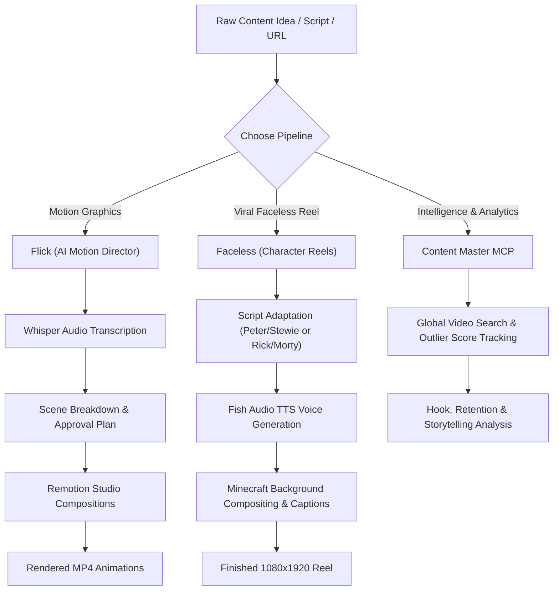

# 🎬 Content Master

<div align="center">

**Open-source AI tools that help creators create better content, faster.**

[](https://opensource.org/licenses/MIT)
[](https://nodejs.org/)
[](https://www.remotion.dev/)
[](https://github.com/baerozgaarmard)

*An open-source AI content creation suite developed and maintained by [Bearozgaarmard](https://github.com/baerozgaarmard).*

</div>

---

## 🌟 Overview

**Content Master** bundles the complete next-generation AI content creation toolkit into a unified, modular monorepo:

| Package | Directory | Role | Description |
|---|---|---|---|
| 🎬 **Flick** | [`packages/flick`](packages/flick) | **AI Motion Director** | Converts videos, links, or scripts into scene-by-scene motion animations rendered with Remotion Studio. |
| 🎭 **Faceless** | [`packages/faceless`](packages/faceless) | **Dialogue Reel Generator** | Creates viral split-screen character reels (Peter & Stewie / Rick & Morty) with Fish Audio TTS and Minecraft parkour backgrounds. |
| ⚡ **MCP Client** | [`packages/mcp`](packages/mcp) | **Agent Data Connector** | Connects Claude Code, Codex, and Antigravity agents directly to video analytics, outlier hooks, and transcript breakdowns. |

---

## 🚀 Quick Install

### 1. Claude Code

Install the tools directly as plugins into Claude Code:

```bash
# Install Flick
/plugin marketplace add baerozgaarmard/content-master
/plugin install flick@content-master

# Install Faceless
/plugin install faceless@content-master
```

### 2. Codex / Antigravity / Agent CLIs

Install globally via `npx skills`:

```bash
# Install Flick
npx skills add baerozgaarmard/content-master --skill flick --global --yes

# Install Faceless
npx skills add baerozgaarmard/content-master --skill faceless --global --yes
```

### 3. Content Master MCP

Connect your AI coding agent to the MCP tools:

```bash
# For Claude Code
npx --yes github:baerozgaarmard/content-master install --client claude

# For Codex
npx --yes github:baerozgaarmard/content-master install --client codex
```

---

## 🛠 Architecture & Workflow



---

## 📦 Packages in this Suite

### 1. [Flick (`packages/flick`)](packages/flick)

Turn any video, link, or script into original short-form scene animations with Remotion.

- **Transcription**: Automatically extracts timestamped speech via bundled Whisper and `yt-dlp`.
- **Dynamic Compositions**: Plans scenes matched to aspect ratios, brand assets, and sound effects.
- **Interactive Studio**: Opens Remotion Studio locally for instant preview and targeted scene revisions.
- **Library of Animations**: Bundled reusable motion templates (OCR models, terminal commands, split views, carousels).

### 2. [Faceless (`packages/faceless`)](packages/faceless)

Create viral Peter & Stewie or Rick & Morty reels locally:

- **Dialogue Engine**: Converts source scripts into punchy dialogue exchanges with synchronized timestamps.
- **Voice Synthesis**: Generates character voices with Fish Audio and merges audio clips locally via FFmpeg.
- **Compositing**: Automatically selects, loops, and synchronizes 60FPS Minecraft parkour backgrounds.
- **Animated Sprites & Captions**: Real-time speaking sprites with uppercase highlighted captions.

### 3. [Content Master MCP (`packages/mcp`)](packages/mcp)

Connect agents directly to video intelligence tools:

- `video-global`: Search millions of videos across YouTube, TikTok, and Instagram.
- `videos-watchlist`: Track high-performing outlier channels in your niche.
- `analyze` & `analysis-result`: Inspect video hooks, structural layout, pacing, and retention drivers.
- `filters`: Automate discovery filters and alerts.

---

## 💻 Local Development

Clone the repository and run checks:

```bash
git clone https://github.com/baerozgaarmard/content-master.git
cd content-master

# Run unit tests across packages
npm test

# Run syntax and integrity checks
npm run check
```

---

## 👤 Author

Developed, packaged, and maintained by **Bearozgaarmard** ([@baerozgaarmard](https://github.com/baerozgaarmard)).

Contributions, issues, and feature requests are welcome! Feel free to check the [issues page](https://github.com/baerozgaarmard/content-master/issues).

---

## 📄 License

This project is licensed under the [MIT License](LICENSE).
Portions derived from Creatorberry under MIT license.
